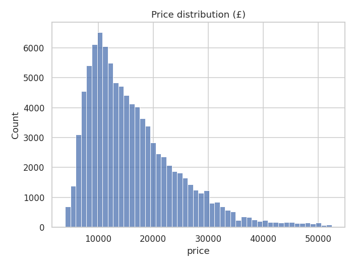
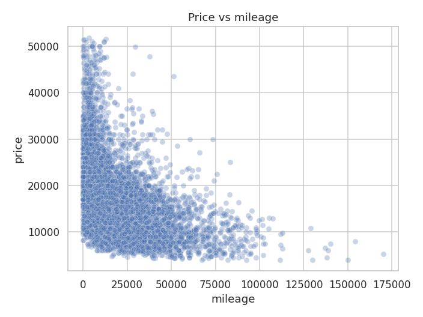
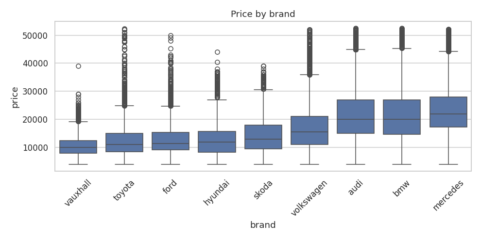
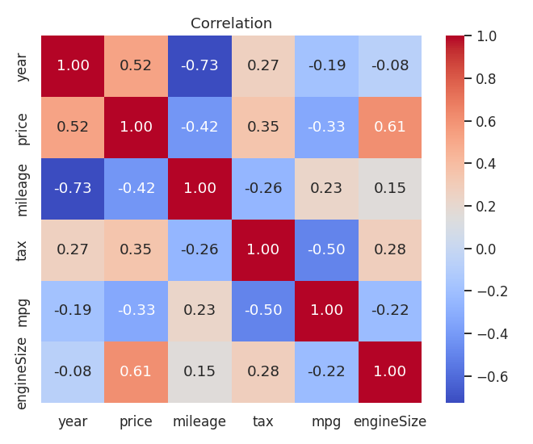

# car-price-predictor
Machine learning web app that estimates the resale price of a used car in the UK.

## Problem
Used car prices depend on age, mileage, engine, fuel type and more. This project predicts the price from those features.

## Data
- Source: [100,000 UK Used Car Data set (Kaggle)](https://www.kaggle.com/datasets/adityadesai13/used-car-dataset-ford-and-mercedes)
- 99,187 raw listings, 95,497 after cleaning (9 brands)
- Cleaning: removed duplicates, missing values, impossible values and extreme price outliers (1st-99th percentile)

## Approach
1. Exploratory data analysis (`notebooks/01_eda.ipynb`)
2. Preprocessing inside a scikit-learn pipeline (scaling + one-hot encoding)
3. Log-transformed target because prices are right-skewed
4. Compared Ridge, Random Forest and XGBoost with 3-fold cross-validation (MAE)
5. Tuned XGBoost with randomized search

## Results
| Model | CV MAE (£) |
|---|---|
| Ridge | 1,538 |
| Random Forest | 1,261 |
| XGBoost | 1,240 |

The tuned XGBoost (700 trees, depth 8, learning rate 0.1) scored on the untouched 20% test set:

**MAE = £1,032, R² = 0.966**

## Exploration highlights
Median price is £14,470 (mean £16,425). Price correlates most with engine size (0.61) and year (0.52), and negatively with mileage (-0.42).

## Run locally
    pip install -r requirements.txt
    streamlit run app.py

## Retrain the model
1. Download the dataset from Kaggle and put the CSV files in `data/raw/`
   (or run `pip install kagglehub` then `python src/download_data.py`)
2. Run:

        python src/prepare.py
        python src/train.py

## Limitations
- Data covers one market and time period
- No information on condition, accident history or service history
- Predictions are estimates, not valuations

## Tech stack
Python, pandas, scikit-learn, XGBoost, Streamlit
